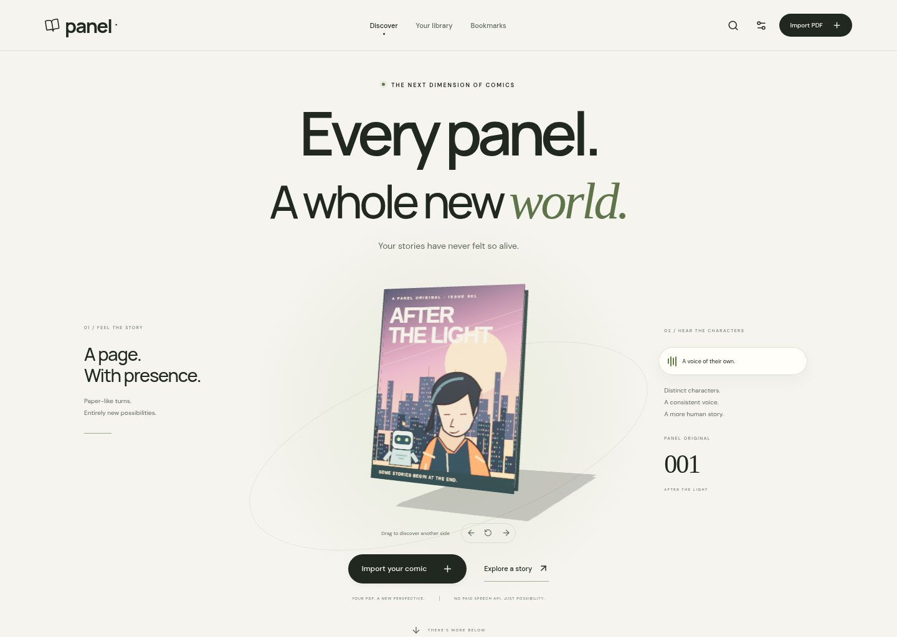
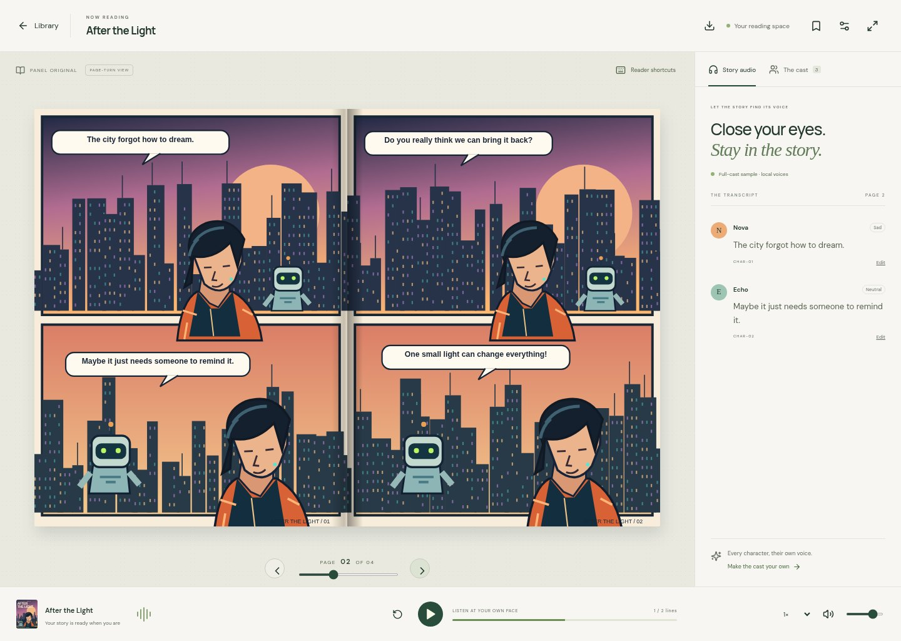

# Panel — stories beyond the page

An accessible comic library and PDF reader, with physical page turning, editable character casting, expressive local neural narration and a synchronized transcript. Built on the original Comic Studies Lab research notebooks, which are preserved unchanged.



<details>
<summary>See the comic reader</summary>



</details>

## What works

- Explore a full-width, cinematic discovery page with an original Three.js book you can drag or rotate with the keyboard, interactive reader scenes, scroll-linked depth and a working character voice studio. Reduced motion, offscreen GPU pausing and a CSS cover fallback keep it usable across devices.
- Import a PDF (up to 40 MB / 100 pages), track processing and resume from your last page.
- Turn physical-looking pages with drag, swipe, buttons, keyboard arrows or a page slider. Single-page and reduced-motion modes are available.
- Extract native PDF text, with CPU EasyOCR for scanned pages. Assign stable character codes and edit speaker assignments, dialogue and emotions.
- Narrate with **Kokoro**, a local open-source neural TTS model: no paid speech API, free-trial dependency or per-character fees. 28 distinct English voice presets, adjustable playback speed/volume, and 13 sentiment-driven expression styles (including joy, fear, hope, anger, sadness, whispering and sarcasm). eSpeak NG is the fallback.
- Free local OpenCLIP visual embeddings, speech-balloon crop proposals and one comic-wide character registry match recurring characters across pages. Each new identity receives an unused voice; later pages keep that assignment. Merge split identities across the entire comic.
- Edit cast names, voices, fictional age/presentation cues and appearance notes; add missed characters or merge duplicate identities. Export the transcript as plain text.
- Paper, midnight and high-contrast themes; larger transcript text, extra spacing, keyboard navigation and focus mode. Preferences and reading position persist in the browser.
- Explore **After the Light**, an original four-page illustrated demo. A static frontend can open the demo with browser speech even without the backend.

## Run the whole application

Requirements: Docker with BuildKit and approximately 4 GB of available memory. Model download and image installation need Internet access during the initial build. Narration and OCR run locally afterward.

```bash
docker compose up --build
```

The Compose port is bound to loopback port 8000. The frontend and API are served together. Persistent library files and SQLite state live in the `panel-library` volume. Open the address locally in your browser; this repository does not create a public tunnel.

In the managed Codex environment:

```bash
bash scripts/setup-cloud.sh
bash scripts/start-cloud.sh
```

The setup script prepares `/workspace/comicstudies-env`, builds the UI, verifies/downloads Kokoro weights and caches OCR weights. It uses the existing checkout and does not create worktrees. The startup script binds to loopback for development. Active server processes must be restarted in fresh tasks.

For separate frontend development, run `npm run dev --prefix frontend` alongside the backend. Vite proxies `/api` to loopback port 8000. Backend changes require a server restart (or `uvicorn --reload` during local development).


## The discovery experience

The discovery page uses original comic artwork and a custom procedural 3D book, with no third-party models, remote image service or tracking scripts. Drag the book or use its three rotation buttons. The reader-feature and character-preview tabs support arrow keys, Home and End. Voice previews request the real sample dialogue from the backend; when the backend is unavailable, any browser-speech preview is explicitly labeled.

The graphics load near the viewport, stop rendering offscreen or in a hidden browser tab, and cap display pixel density. OS-level reduced motion and the in-app setting stop automatic motion while preserving the controls. If WebGL is unavailable or its context is lost, a textured CSS cover remains interactive. The actual reader uses its existing paper-turn renderer and can switch to a simple image view independently.

## Free local character intelligence

The default stack needs **no API key, trial or paid AI service**:

1. Native PDF text or EasyOCR finds the words and their locations.
2. Computer vision finds likely speech-balloon regions and nearby character crop proposals. OpenCLIP selects character-rich crops and encodes appearance into visual embeddings.
3. One character registry spans the entire comic. Confident matches reuse the same character code and frozen voice assignment. Explicit speaker names are stronger cues than visual similarity. Ambiguous matches stay unassigned for review instead of receiving an arbitrary voice.
4. Zero-shot image/text comparisons propose a fictional age group, masculine/feminine/unspecified presentation, clothing/hair cues, or a robot-like character type. Explicit labels such as “Grandpa” also provide voice-design cues. The allocator selects an unused voice suitable for those cues; up to 24 cast members are supported from 28 available presets.
5. VADER sentiment plus negation-aware affect cues selects one of 13 expression styles and an intensity. Kokoro runs locally; pace, pitch and amplitude follow the selected style and intensity.

These are **editable proposals**, not reliable facts about age, gender identity or biometric identity. Complex panel layouts, obscured characters, costume changes and tiny faces can confuse the matcher. Age/presentation can remain unspecified when the evidence is weak. Confirm the cast in the reader, choose a different voice, or merge duplicate identities to fix every affected page at once. A character's voice never changes automatically simply because a later crop looks older or different. Manual voice changes apply to that character throughout the comic; assigning another character's occupied voice is rejected.

Kokoro offers many timbres but is not an emotion-conditioned acting model: expressions use punctuation, voice choice, speed, pitch and amplitude. It does not clone actors or promise human-level emotional performance. Newly imported PDFs use this pipeline; older completed uploads keep their original analysis and can be reimported to use the new matcher.

An optional external vision adapter is retained for experimentation. It is disabled by default, even if a key exists. Only setting both `PANEL_USE_EXTERNAL_VISION=1` and `PANEL_VISION_KEY` enables it; this can incur provider charges and is unnecessary for local casting or speech. Its live provider path remains unvalidated without a configured account.

## Deployment

### Full stack on Render

[](https://render.com/deploy?repo=https://github.com/Sidharth8100/ComicStudiesLabApp)

Deploy the frontend and backend together at one HTTPS address using `render.yaml`. The Blueprint uses one Pro Docker service and a persistent 10 GB disk; hosting and disk charges are shown in Render before deployment. TTS, OCR and character intelligence remain local and free of API fees.

Follow [the hosting guide](docs/HOSTING.md) to create the service, check readiness, validate the actual public app through **Actions → Verify hosted Panel**, and preserve uploaded comics. No GitHub Pages setup or separate frontend API URL is needed for this path.

### Frontend on GitHub Pages

`.github/workflows/pages.yml` is optional. Enable Pages publishing in repository settings, then set `PANEL_PAGES_ENABLED=true` to deploy automatically on pushes to `main`, or run the workflow manually. GitHub Pages must be enabled for the repository with **GitHub Actions** as the publishing source. A workflow token alone cannot enable Pages on an unconfigured repository.

For full functionality, set the repository Actions variable `PANEL_API_URL` to your backend's HTTPS origin. Set backend `PANEL_ALLOWED_ORIGINS` to the exact Pages origin (for example, `https://sidharth8100.github.io`). With no backend URL, Pages provides the authored sample and browser narration; uploads require the backend.

Deployment configuration is not evidence of a live deployment. Check Actions and the hosting service before sharing a public URL.

## Privacy and operational limits

This is a capability-key personal-library prototype, not an account-based production service. A random 256-bit library key stays in browser local storage; API authorization checks protect book metadata, images, edits and audio. Clearing browser storage loses library access. There is no login, account recovery or cross-device synchronization. Anyone who obtains the key can access that library, so production HTTPS and protection against script injection are essential.

Uploaded PDFs, rendered pages, dialogue and audio are stored on the server. The optional vision provider receives page images only when explicitly enabled with `PANEL_USE_EXTERNAL_VISION=1` and a key. Deleting a finished comic removes its database record and directory. Processing jobs must finish before deletion. Interrupted jobs can be retried after a restart.

Limits: 20 books per library, two active uploads per key, eight active jobs globally and 500 books per instance. Two worker threads process jobs. These quotas are not a substitute for authentication, rate limiting, a durable external queue, storage monitoring and abuse controls before opening an unrestricted public service. No credentials are included in committed files.

## Validation

```bash
python -m pytest -q tests
npm ci --prefix frontend
npm run build --prefix frontend
python scripts/make_test_pdf.py
# Start the backend, then in another terminal:
npm run test:e2e --prefix frontend
```

The browser tests cover a real upload, edited transcript, physical page turns, cast voice edits, keyboard navigation, mobile overflow, narration controls and automated WCAG A/AA checks of the library and reader. Discovery checks exercise real voice previews, arrow-key feature tabs, book rotation, mobile navigation/search, reduced motion, dark/high-contrast scenes and a deliberately unavailable WebGL context. A separate Pages-style subpath test verifies that static assets and API calls also work when frontend and backend have different origins. API tests cover invalid/encrypted PDFs, page limits, ownership isolation, image retrieval, editable casting, speech WAV generation and scanned-image OCR when cached models are available. Automated accessibility checks do not replace testing with screen readers and disabled readers.

Local Chromium defaults to `/usr/bin/chromium`. Set `CHROMIUM_PATH` to override it. CI installs Playwright's Chromium. Failed browser tests save screenshots and accessibility context in `frontend/test-results/`.

## Project map

- `frontend/src/App.tsx` — library, reader, cast studio, import flow and accessibility controls.
- `frontend/src/styles.css` — responsive editorial interface and reading themes.
- `frontend/src/components/Showcase.tsx` and `showcase.css` — cinematic discovery scenes, accessible feature tabs and real character voice previews.
- `frontend/src/components/BookSculpture.tsx` — lazy-loaded, locally textured 3D book with pointer/keyboard controls, visibility-based rendering and a WebGL fallback.
- `backend/main.py` — private library API, PDF extraction, OCR and optional vision analysis.
- `backend/speech.py` — neural voice synthesis and sentiment-scaled expressive prosody.
- `backend/casting.py` — free local visual embeddings, balloon crop proposals and global identity matching.
- `backend/voice_catalog.py` — 28 distinct voices, profile cues and 13 expression styles.
- `backend/sentiment.py` — VADER sentiment, negation and affect cues.
- `backend/sample.py` — original procedural comic illustrations and sample dialogue.
- `scripts/models.json` — official Kokoro/OpenCLIP model URLs and pinned SHA-256 digests.
- `tests/`, `frontend/e2e/` — API, browser and accessibility integration tests.

See [THIRD_PARTY.md](THIRD_PARTY.md) for design references, attribution and dependency licenses. In particular, the open-source PyMuPDF edition has AGPL obligations; review these before proprietary redistribution.

## Deployment regression checks

The production health check follows the hosting platform's `PORT` value, including non-default ports. The expanded browser suite covers real audio auto-advance, transcript downloads, saved-position recovery, viewport rotation, damaged browser storage, all theme contrast checks, voice uniqueness and cross-page character merges.

After starting an isolated test deployment, run:

```bash
python scripts/verify_deployment.py --base-url YOUR_BACKEND_ORIGIN --full-matrix --report /tmp/panel-validation.json
```

This creates a temporary private library with synthetic PDFs and checks all 28 × 13 voice/expression combinations for valid, audible, distinct WAV output, plus OCR, authorization, configured-origin CORS, edits, cache consistency and cleanup. `--docker-container NAME` additionally tests restart persistence and only accepts a container labeled `panel.validation=true`. Reported local-container results must not be presented as a verified public deployment. Public hosting still requires Pages enablement and a backend hosting account.
